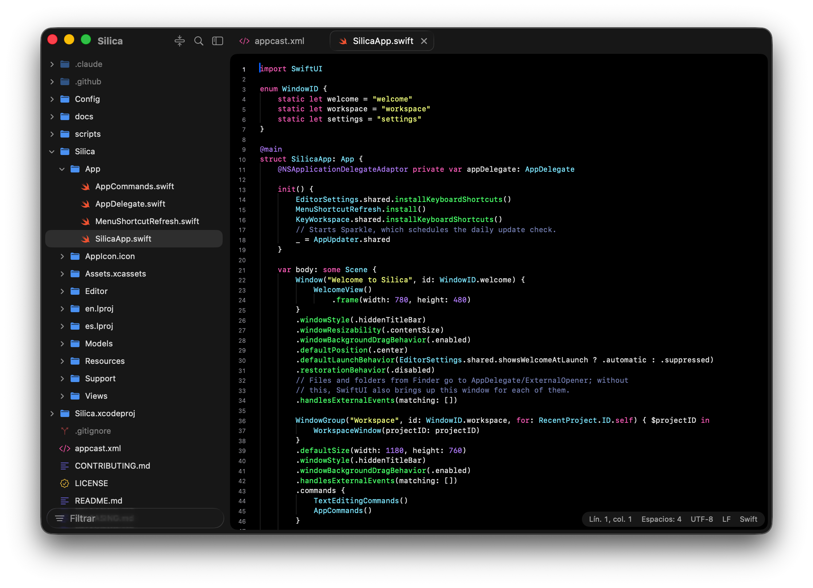

# Silica

A lightweight code editor for macOS, made of glass. Open a folder, find files fast, and edit with syntax highlighting, a minimap and a Markdown preview, all in a native SwiftUI and AppKit app.

## Personal motivation

I really like the original project and the Silica app, which works very well on macOS 26 and 27. I have made a few changes to the project, tailored to my personal preferences. Without any intention of interfering with the original project—which I consider an excellent piece of work—here are the changes I have made in my fork:

- Localize the interface and alerts, adding a simple language system with English (default) and Spanish
- Add an option to switch between glass and opaque window styles, since I prefer opaque windows
- Choose whether to start with the welcome window, an empty workspace, or a blank text file
- Migrate the Xcode project to `pbxproj` format for compatibility
- Update the release script, not actually used for the release available in this fork.

## Download

Get the latest DMG from [Releases](https://github.com/perez987/Silica/releases/latest), open it and drag Silica to Applications. Silica checks for updates once a day and installs them for you; you can turn that off in Settings › General.

Silica needs macOS 26 or later.

## Features

- **Projects.** Open a folder to get a window with a file tree and Finder folder icons. Files and folders your `.gitignore` excludes are dimmed, and the tree updates as files change on disk. Create, rename and move files to the Trash, drag files and folders (including the project icon beside its name) to other apps, filter the tree as you type, and reveal a tab's file from its menu.
- **Quick Open and project search.** Jump to any file with fuzzy matching, or search the text of every file in the project.
- **Syntax highlighting** for 26 languages, including Swift, JavaScript, TypeScript, Python, Go, Rust, C, C++, Java, Kotlin, HTML, CSS, JSON, YAML, Markdown and diff files.
- **Nine color themes**, each with a light and a dark palette: Atom One, GitHub,
  Xcode, Solarized, Catppuccin, Gruvbox, Tokyo Night, Rosé Pine and Dracula.
- **Markdown preview**, with highlighted code blocks.
- **CSV and TSV preview**, with a table view and double-click to edit a row.
- **HTML preview**, including unsaved edits, project assets and page scripts.
- **PDF viewing**, including password-protected files.
- **Editing tools.** Tabs, line numbers, indent guides, a minimap, word wrap, go to line, toggle comment, and moving or duplicating lines.
- **New files.** Press `⌘N` to start an empty plain-text file, even without an open project. Choose where to save it when ready.
- **Picks up where you left off.** Projects reopen their tabs, and recent projects are on the welcome window. Choose the welcome window, an empty workspace, or a blank text file at launch in Settings › General. Reopen the welcome window with File › Welcome Window or `⇧⌘1`.
- **Appearance and language.** Choose glass or opaque windows in Settings › General. The opaque editor background is black in dark appearance and white in light appearance. Silica follows the macOS language preference, with English and Spanish available.
- **Works with Finder.** Use Open With, drop files on the Dock icon, or run
  `open -a Silica <path>`.

## Keyboard shortcuts

| Shortcut     | Action                                    |
| ------------ | ----------------------------------------- |
| ⇧⌘1          | Show welcome window                       |
| ⌘N           | New file                                  |
| ⌘P           | Quick Open                                |
| ⇧⌘F          | Find in Project                           |
| ⌥⌘J          | Filter files in the tree                  |
| ⌘L           | Go to Line                                |
| ⇧⌘V          | Toggle Markdown, CSV, TSV or HTML preview  |
| ⌃⌘S          | Show or hide the sidebar                  |
| ⌘/           | Toggle comment                            |
| ⌥↑ / ⌥↓      | Move lines up or down                     |
| ⇧⌥↑ / ⇧⌥↓    | Duplicate lines up or down                |
| ⌥Z           | Word wrap                                 |
| ⌘+ / ⌘− / ⌘0 | Increase, decrease or reset the font size |

## Building from source

You need Xcode 27 or later.

1. Clone the repository and open `Silica.xcodeproj`.
2. In the Silica target's Signing & Capabilities, choose your own team (or "Sign to
   Run Locally"). Please don't commit that change.
3. Press ⌘R. Xcode fetches the Swift packages on the first build.

## Contributing

Bug reports, ideas and pull requests are welcome. Read
[CONTRIBUTING.md](CONTRIBUTING.md) before you start on a change.

## License

Silica is released under the [MIT License](LICENSE). It includes
[swift-markdown](https://github.com/swiftlang/swift-markdown),
[swift-cmark](https://github.com/swiftlang/swift-cmark) and
[Sparkle](https://sparkle-project.org), whose licenses are in
`Silica/Resources/Licenses` and in Settings › About.
